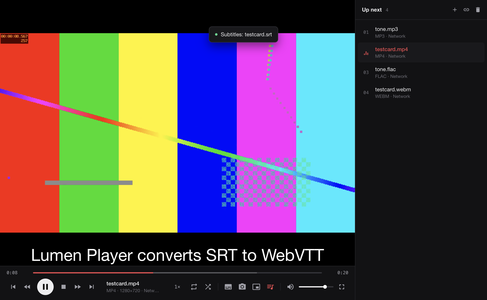
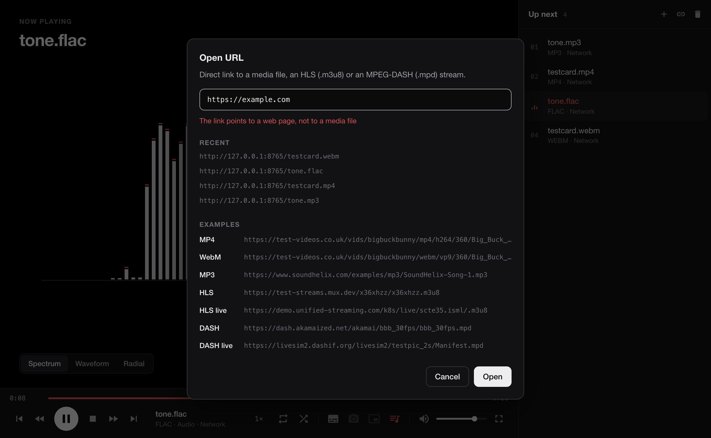
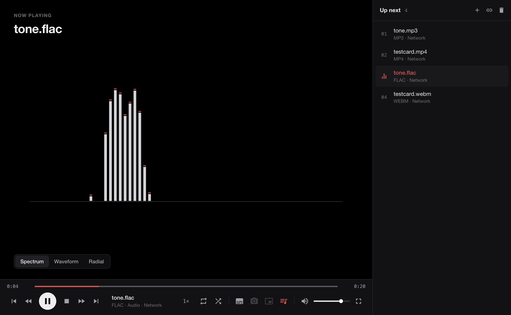
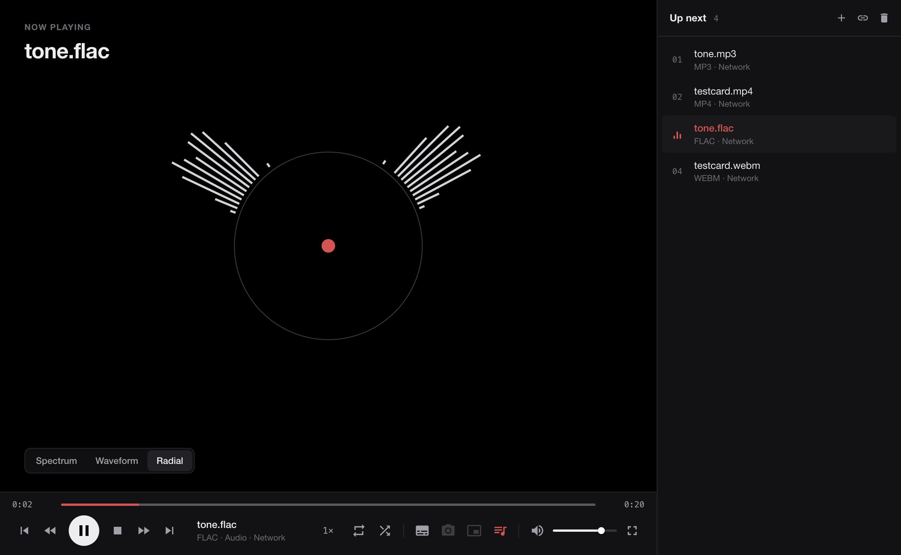
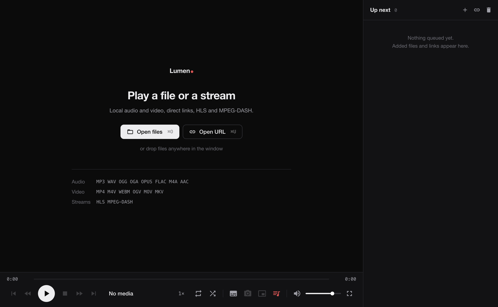
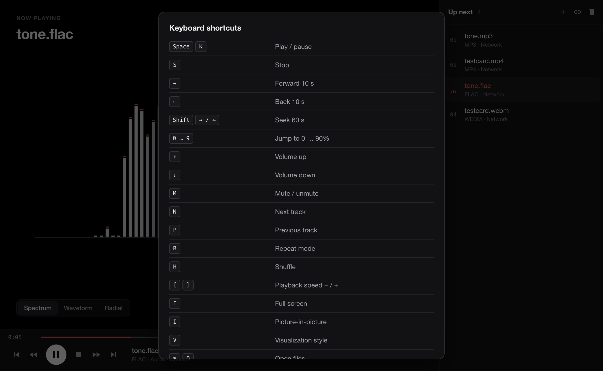

# Media Player — Lab Work 2

**Course:** Multimedia Systems Development
**Topic:** Developing a multimedia application with modern technologies
**Variant 1:** Media player (desktop application)



## Technology stack

| Layer | Technology |
| --- | --- |
| Desktop shell | Electron 44 (Chromium + Node.js) |
| Language | JavaScript (ES2023, ES modules) |
| Playback | HTML5 `HTMLMediaElement` (Chromium's built-in codecs) |
| Streaming | [hls.js](https://github.com/video-dev/hls.js) (HLS), [dash.js](https://github.com/Dash-Industry-Forum/dash.js) (MPEG-DASH) |
| Audio visualization | Web Audio API (`AnalyserNode`, FFT) + Canvas 2D |
| Tests / quality | `node:test` (unit tests), ESLint 9 |

Third-party libraries are used only for HLS/DASH.

## Getting started

Requires Node.js ≥ 22.

```bash
npm install                      # install dependencies
npm start                        # run the app
npm start -- path/to/video.mp4   # run the app and open a file
npm run dev                      # run with DevTools
npm test                         # unit tests
npm run lint                     # static analysis
npm run samples                  # generate test media into samples/ (requires ffmpeg)
```

## Requirements coverage

| Requirement | Implementation |
| --- | --- |
| Open a local media file | "Open file" button, *File → Open File…* (`Ctrl/⌘+O`), drag & drop, command-line arguments, OS "Open with…". Multiple selection fills the playlist |
| Play / Pause and Stop | Buttons, `Space`/`K`, `S`, click on the video, menu, OS media keys. Stop pauses and rewinds to the beginning |
| Seek forward / backward | ±10 s (buttons, `←`/`→`), ±60 s (`Shift+←/→`), jump to 0–90 % (`0…9`), previous/next track |
| Seeking with a progress bar | Custom `Timeline` component: click and drag, time tooltip under the cursor, buffered range indicator, keyboard control (`←/→/Home/End` when focused), ARIA `role="slider"` |
| Current and total time | `0:42 / 3:15`, `h:mm:ss` for long media, `LIVE` for live streams |
| Volume control | Slider, mute button, `↑/↓`, `M`, mouse wheel over the video. Level and mute state persist between sessions |
| ≥ 2 audio and ≥ 2 video formats | Audio: **MP3, WAV, OGG, FLAC, M4A/AAC, Opus**. Video: **MP4 (H.264), WebM (VP9), MKV, MOV, OGV** |
| Playback from a URL | "Open URL" dialog (`Ctrl/⌘+U`) with link verification, history and examples. Progressive download (MP4/WebM/MP3…), **HLS** (`.m3u8`) and **MPEG-DASH** (`.mpd`), including live streams |

### URL validation

A link is verified **before** it reaches the player, so a broken or wrong link produces a clear message instead of a silent playback failure:

1. **Syntax** (instant, in the renderer): only `http://` / `https://`, a host is required, a missing scheme defaults to `https://`. `file:`, `javascript:`, `ftp:` etc. are rejected.
2. **Network probe** (main process, `src/main/url-probe.cjs`): a `HEAD` request (falls back to a 1 KB ranged `GET` for servers that reject `HEAD`) with a 10-second timeout. The main process re-validates the URL itself and does not trust the renderer.
3. **Response check** (`evaluateProbeResponse` in `src/shared/formats.js`, unit-tested):
   - HTTP errors → *"The file was not found on the server (HTTP 404)"*, *"Access to the file is denied (HTTP 403)"*, …
   - network errors → *"The host name could not be resolved"*, *"The server refused the connection"*, invalid TLS certificate, timeout;
   - `Content-Type: text/html` → *"The link points to a web page, not to a media file"* (this also catches "soft 404" pages served for `.mp4` links);
   - other non-media types (`image/png`, `application/json`, …) are rejected;
   - `audio/*`, `video/*`, `application/octet-stream` are accepted;
   - HLS/DASH are recognized **by Content-Type** too (`application/vnd.apple.mpegurl`, `application/dash+xml`), so streams without a `.m3u8`/`.mpd` extension are opened with the right client.

The dialog shows a *"Checking the link…"* state and locks input while the check runs. Links dropped onto the window go through the same validation. Only verified links are saved to the "Recent" list.



### Verified formats

All files were generated with `npm run samples` (ffmpeg) and tested both locally (`file://`) and over HTTP:

| File | Container / codec | Result |
| --- | --- | --- |
| `tone.mp3` | MP3 | ✅ |
| `tone.wav` | WAV / PCM 16-bit | ✅ |
| `tone.ogg` | Ogg / Vorbis | ✅ |
| `tone.flac` | FLAC | ✅ |
| `tone.m4a` | MP4 / AAC | ✅ |
| `testcard.mp4` | MP4 / H.264 + AAC, 1280×720 | ✅ |
| `testcard.webm` | WebM / VP9 + Opus | ✅ |
| `testcard.mkv` | Matroska / H.264 + Opus | ✅ |
| Big Buck Bunny (test-videos.co.uk) | MP4 and WebM over HTTPS | ✅ |
| Mux test stream | HLS VOD | ✅ |
| Unified Streaming demo | HLS live | ✅ |
| Akamai BBB | MPEG-DASH VOD (adaptive bitrate) | ✅ |
| DASH-IF livesim2 | MPEG-DASH live | ✅ |

## Extra features

- **Playlist**: multiple files/URLs, switching, removing, repeat modes (off / playlist / track) and shuffle (Fisher–Yates, no repeats within a cycle), auto-advance.
- **Audio visualization**: spectrum with falling peak caps (log-scaled FFT bands), waveform, radial — switched with a segmented control or `V`.
- **Subtitles** `.srt` / `.vtt` from the menu or by drag & drop; SRT is converted to WebVTT on the fly.
- **Playback speed** 0.5×–2× (`[` / `]`).
- **Full screen** (`F`, double click) with auto-hiding controls; **picture-in-picture** (`I`).
- **Frame capture** to PNG at native resolution (`Ctrl/⌘+Shift+S`).
- **Source info**: format/protocol, resolution, origin (local file / network / live); updates when adaptive streams switch quality.
- **OS integration**: media keys and the system "Now Playing" widget (Media Session API), window title shows the track, files open from Finder/Explorer, single app instance.
- **Visual design**: neutral graphite palette with a single red accent reserved for state (progress, active modes, the current track, live indicator, errors); flat surfaces with hairline borders, monospaced tabular figures for time codes, colors defined once as CSS custom properties (the canvas visualizer reads the same tokens).
- **UX**: drag & drop with a highlighted drop zone, OSD feedback (volume, seek, speed), human-readable error toasts, loading/buffering spinner, shortcut reference (`F1`), persisted settings, layout-independent hotkeys (`KeyboardEvent.code`), `prefers-reduced-motion` support.

| Audio (spectrum) | Audio (radial) |
| --- | --- |
|  |  |

| Start screen | Keyboard shortcuts |
| --- | --- |
|  |  |

## Architecture

```
src/
├── shared/
│   └── formats.js            # formats, source classification, URL rules (used by main and renderer)
├── main/                     # Electron main process
│   ├── main.cjs              # app and window lifecycle
│   ├── ipc.cjs               # IPC: file dialogs, subtitle reading, frame saving, URL probing
│   ├── url-probe.cjs         # network check of media URLs
│   ├── menu.cjs              # native menu
│   ├── cors.cjs              # CORS headers for network media
│   ├── media-files.cjs       # file paths → file:// descriptors
│   └── preload.cjs           # minimal API exposed to the renderer via contextBridge
└── renderer/
    ├── index.html, styles/main.css
    └── js/
        ├── app.js            # composition root: creates and wires objects
        ├── app-commands.js   # use cases (commands)
        ├── persistence.js    # settings persistence
        ├── core/             # logic independent of the markup
        │   ├── player.js            # Player — facade over HTMLMediaElement + state machine
        │   ├── stream-adapters.js   # loading strategies: progressive / HLS / DASH
        │   ├── media-controller.js  # coordinates playlist and player
        │   ├── playlist.js          # playlist model (repeat / shuffle)
        │   ├── settings.js, time.js, subtitles.js
        ├── ui/               # views
        │   ├── controls-view.js, timeline.js, stage-view.js, playlist-view.js
        │   ├── visualizer.js, dialogs.js, notifications.js, fullscreen.js
        │   ├── commands.js, shortcuts.js, drag-drop.js, dom.js, source-description.js
        └── services/         # integrations: url-validator.js, media-session.js, frame-capture.js
```

**Key design decisions:**

- **Facade + state machine.** `Player` hides `HTMLMediaElement` details and has explicit states (`idle → loading → playing ⇄ paused → stopped/ended/error`). Views subscribe to player events, never to the media element directly.
- **Strategy.** `createStreamAdapter()` picks a loading strategy by source type (progressive, hls.js, dash.js). A new protocol is added without touching `Player` (open/closed principle). HLS/DASH libraries are loaded lazily with dynamic `import()`.
- **Command.** Every user action has a single implementation in `app-commands.js` and runs through `CommandRegistry`: buttons (`data-command`), hotkeys, the native menu (via IPC) and OS media keys. The shortcut table (`shortcuts.js`) is the single source for both the key handler and the help dialog.
- **Observer.** Models (`Player`, `Playlist`) are `EventTarget`s; views only render their state (one-way data flow).
- **Dependency injection.** Dependencies are passed through constructors in `app.js`, so models (`Playlist`, `Settings`, `formats`, `time`, `subtitles`) are tested without a DOM, with the RNG and storage replaced by test doubles.
- **One shared format definition** for the file-dialog filters (main), URL rules (main + renderer) and player logic (renderer).

### Security

- `contextIsolation: true`, `sandbox: true`, `nodeIntegration: false`; the renderer sees only 7 explicitly defined preload functions.
- Content-Security-Policy without `unsafe-inline` / `unsafe-eval`.
- Window navigation and new windows are blocked.
- URLs are validated on both sides of IPC (scheme whitelist + network probe); screenshot data is validated in the main process before it is written to disk.
- For network media the main process adds CORS headers (`cors.cjs`). Without them the Web Audio visualizer and frame capture fail on servers that send no `Access-Control-Allow-Origin`, and HLS/DASH segments cannot be fetched.

## Testing

**Unit tests** (`npm test`, 27 tests): extension and source-type parsing, URL validation, probe response evaluation (HTTP errors, web pages, non-media types, HLS/DASH detection by Content-Type), time formatting, pointer-to-time mapping, buffered ranges, SRT → VTT conversion, playlist (repeat/shuffle/removal/events), settings (corrupted and unavailable storage, recent URLs).

**Manual / end-to-end checks** (driving the running app through the Chrome DevTools Protocol):
- every format in the table above, locally and over HTTP;
- Play/Pause, Stop (position 0), ±10 s, progress-bar drag, `0…9`, volume, mute, speed;
- next/previous, repeat, shuffle, clearing the playlist;
- SRT subtitles via drag & drop;
- HLS/DASH VOD and live (`LIVE`, progress bar disabled);
- URL validation: wrong scheme, unknown host, HTTP 404, HTML page, image, valid file and HLS stream; dropped links;
- full screen with auto-hiding controls; visualizer and frame capture for network sources without CORS headers.
