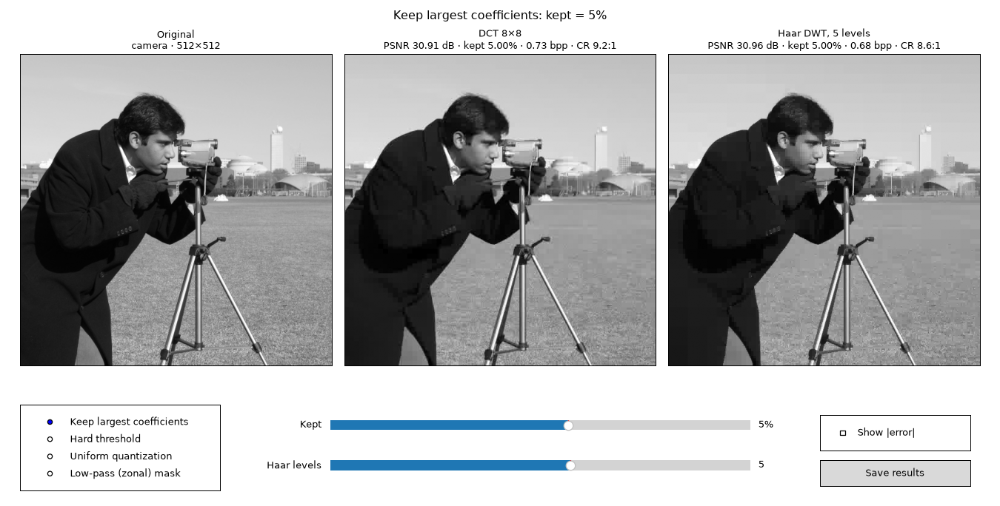
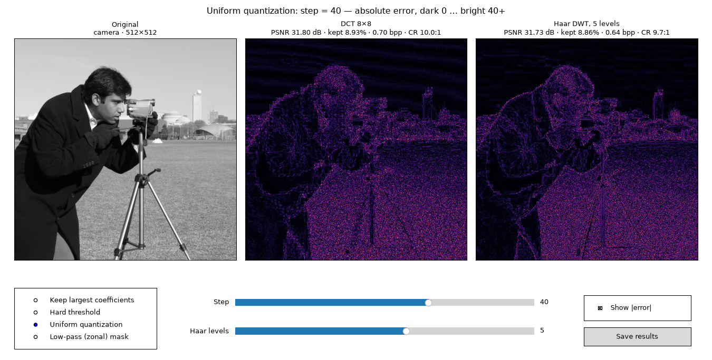
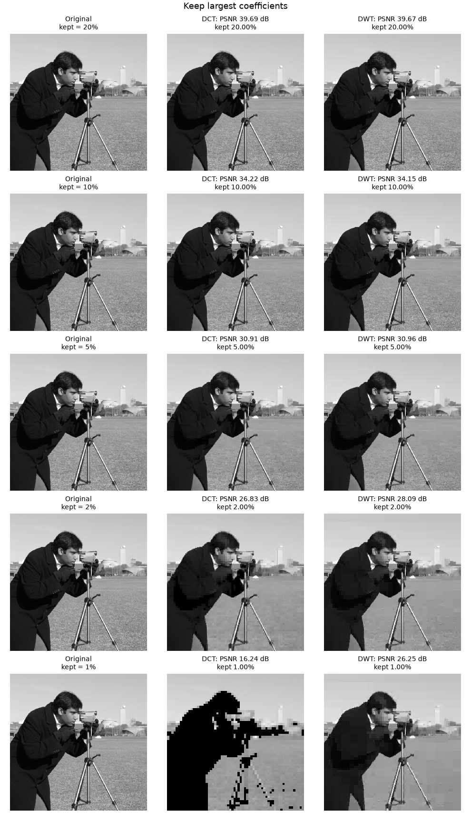
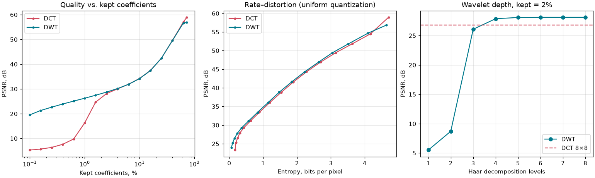
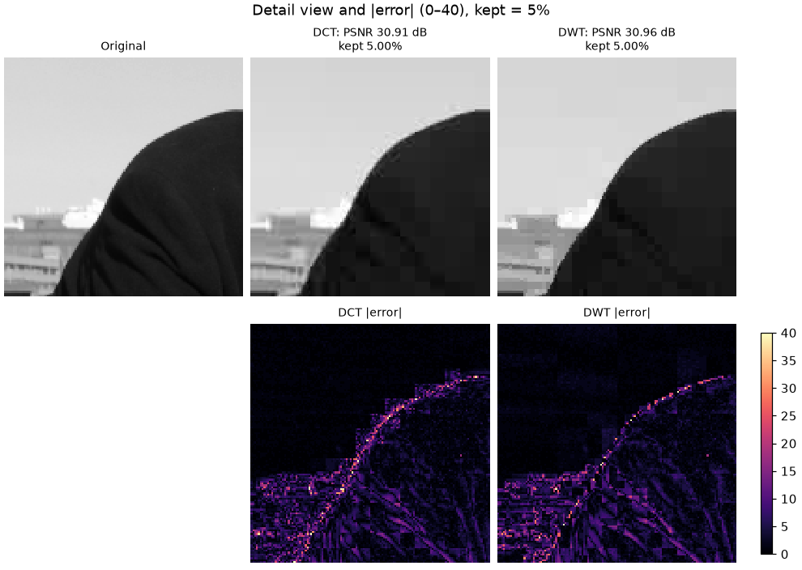
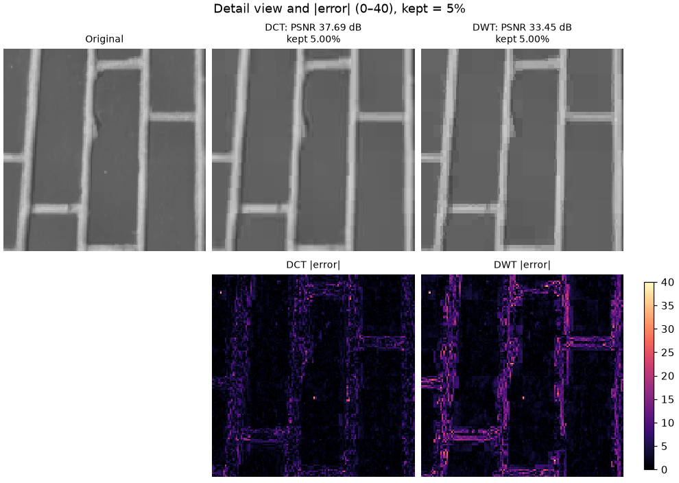

# Lab Work No. 3: Lossy Compression with DCT and DWT

**Course:** Multimedia Systems Development
**Topic:** Implementing lossy compression algorithms

The program compresses grayscale images in two ways and shows the results side by side as **Original | DCT | DWT**, with PSNR for each method:

- a block DCT-II, 8×8 blocks, written in matrix form;
- a multi-level Haar wavelet transform (DWT), also in matrix form.

Both transforms, their inverses, coefficient reduction, PSNR and the rate estimates are implemented from scratch. NumPy is used only for arrays and matrix products, Pillow for image I/O, and Matplotlib for the UI and charts. No ready-made `dct`, `idct`, `dwt` or `idwt` functions are used.



## Quick start

You need Python ≥ 3.11 and [uv](https://docs.astral.sh/uv/). Plain `pip install -e .` also works.

```bash
uv sync                                                   # create .venv and install dependencies
uv run lossy-compression view images/camera.png           # interactive comparison
uv run lossy-compression compress images/camera.png --strategy quantization --value 50
uv run lossy-compression experiment images/*.png          # all experiments → results/
uv run pytest                                             # unit tests
uv run ruff check .                                       # linter
```

`--levels N` before the sub-command sets the Haar depth. The default is 5. For example:

```bash
uv run lossy-compression --levels 3 view images/brick.png
```

### Interactive viewer

| Control | Action |
| --- | --- |
| Radio buttons | Compression strategy: keep largest / hard threshold / uniform quantization / low-pass zonal mask |
| Upper slider | Compression level, on a logarithmic scale: kept %, threshold T, quantization step, or low-frequency share |
| *Haar levels* slider | DWT decomposition depth (1…8) |
| *Show \|error\|* | Replaces the reconstructions with absolute error maps on a shared scale |
| *Save results* | Writes both reconstructions and the window to `results/viewer/` |
| Toolbar zoom / pan | The three panels share axes, so zooming one zooms all of them, which makes artifacts easy to compare |

Each panel title shows the PSNR, the kept-coefficient share, the entropy in bits per pixel and the compression ratio. Everything is recomputed as soon as a control changes.



## Algorithms

### DCT (matrix form)

The orthonormal DCT-II matrix of size N = 8 is defined as:

$$C_{k,n} = \alpha(k)\cos\frac{(2n+1)k\pi}{2N},\qquad \alpha(0)=\sqrt{1/N},\ \alpha(k>0)=\sqrt{2/N}$$

The image is reshaped into a `(H/8, W/8, 8, 8)` stack of blocks. Every block is transformed with two matrix products. NumPy broadcasts the `@` operator over all blocks at once:

- forward: $Y = C\,X\,C^{T}$;
- inverse: $X = C^{T}\,Y\,C$. This works because $C$ is orthogonal, so $C^{-1} = C^{T}$.

Code: `src/lossy_compression/dct.py`, functions `dct_matrix`, `BlockDCT.forward` and `BlockDCT.inverse`.

### Haar DWT (matrix form)

One analysis step for a signal of length N is an N×N orthonormal matrix $H_N$:

- the first N/2 rows compute $(x_{2i}+x_{2i+1})/\sqrt2$, a low-pass average;
- the last N/2 rows compute $(x_{2i}-x_{2i+1})/\sqrt2$, a high-pass difference.

One 2-D level is $A \leftarrow H_{rows}\,A\,H_{cols}^{T}$. It produces the approximation **LL** (top-left) and three detail subbands. Each next level transforms only the current LL region, which gives the Mallat pyramid. The inverse runs the levels in reverse order, using $A \leftarrow H^{T}_{rows}\,A\,H_{cols}$.

Code: `src/lossy_compression/haar.py`, functions `haar_matrix`, `HaarDWT.forward` and `HaarDWT.inverse`.

Both transforms are **orthonormal**, so they preserve energy (Parseval's theorem). This has two practical consequences:

- coefficients of different frequencies and subbands are on the same scale, so DCT and DWT can be compared with the same reduction rule;
- the squared error in the coefficient domain equals the squared error of the image.

### Pipeline

```
image ─► pad to a multiple of 8 / 2^levels ─► forward transform ─► reduce coefficients
      ─► integer symbols (what an encoder would store) ─► inverse transform ─► crop, round, clip to uint8 ─► PSNR
```

The same `Reducer` object is applied to both transforms. This keeps the comparison fair.

### Compression strategies (`reduction.py`)

| Strategy | Parameter | Rule |
| --- | --- | --- |
| Keep largest | kept % | Keeps the given share of coefficients with the largest magnitude over the whole image. Both methods get exactly the same coefficient budget |
| Hard threshold | T | Coefficients with \|c\| < T are set to zero |
| Uniform quantization | step Δ | $\hat c = \Delta \cdot \mathrm{round}(c/\Delta)$. Small coefficients become zero, and the rest are coarsened |
| Low-pass (zonal) mask | low-frequency share | Keeps whole frequency classes up to the share. For DCT these are zig-zag positions in every block; for DWT they are subbands from coarse to fine. Content is ignored |

### Metrics (`metrics.py`)

- **PSNR** is $10\log_{10}(255^2/\mathrm{MSE})$. It is computed on the final 8-bit image, after rounding and clipping.
- **Kept, %** is the share of nonzero coefficients after reduction.

There are three compression ratio definitions, because the number of nonzero coefficients and the size of an encoded file are not the same thing:

1. **CR nonzero** = total coefficients / nonzero coefficients. It ignores the cost of storing the values and positions of the kept coefficients.
2. **Entropy, bpp** is the zero-order Shannon entropy of the integer symbols × the number of symbols / the number of pixels. **CR entropy** = 8 / bpp. This is the bound for an ideal entropy coder.
3. **CR deflate** = raw image bytes / bytes produced by zlib (level 9) after the symbols are serialized in frequency order. This is a real, decodable size.

For example, *camera* with 1% of coefficients kept gives:

| Measure | DCT | DWT |
| --- | --- | --- |
| CR nonzero | 100:1 | 100:1 |
| CR entropy | ≈ 48:1 | ≈ 46:1 |
| CR deflate | 55:1 | 32:1 |

## Experiments

There are three 512×512 grayscale test images from scikit-image's public-domain data set:

- *camera*: a photo with smooth areas, sharp edges and a textured lawn;
- *astronaut*: a photo with many mid-frequency details;
- *brick*: a periodic texture.

`uv run lossy-compression experiment images/*.png` runs every strategy at 4–5 levels and writes the following:

- `results/summary.md`: all tables (16 experiments per method and image);
- `results/experiments.csv`: raw data;
- `results/<image>/<strategy>.png`: an Original | DCT | DWT grid for every level;
- `results/<image>/detail.png`: a zoomed crop of the most detailed region with error maps;
- `results/<image>/rate-distortion.png`: quality curves.

The Haar depth is 5 levels. In all tables, the larger PSNR is shown in **bold**.

### Keep largest coefficients: same budget for both methods

| Kept | camera DCT | camera DWT | astronaut DCT | astronaut DWT | brick DCT | brick DWT |
| --- | --- | --- | --- | --- | --- | --- |
| 20% | **39.69** | 39.67 | **42.53** | 40.01 | **48.32** | 47.10 |
| 10% | **34.22** | 34.15 | **36.38** | 33.99 | **43.28** | 39.42 |
| 5% | 30.91 | **30.96** | **31.24** | 29.62 | **37.69** | 33.45 |
| 2% | 26.83 | **28.09** | 25.06 | **25.39** | 26.92 | **28.76** |
| 1% | 16.24 | **26.25** | 16.84 | **23.00** | 12.40 | **25.66** |

PSNR is in dB.



### Uniform quantization on camera: closest to a real codec

| Step | Kept, % (DCT / DWT) | PSNR, dB (DCT / DWT) | Entropy, bpp (DCT / DWT) | CR deflate (DCT / DWT) |
| --- | --- | --- | --- | --- |
| 10 | 29.89 / 29.61 | 41.44 / **41.44** | 1.875 / 1.805 | 3.6 / 3.7 |
| 25 | 15.25 / 15.32 | 34.81 / **34.81** | 1.050 / 0.988 | 6.5 / 6.6 |
| 50 | 6.68 / 6.45 | **30.58** / 30.51 | 0.568 / 0.498 | 12.9 / 12.4 |
| 100 | 3.06 / 2.39 | **27.77** / 27.61 | 0.304 / 0.223 | 32.2 / 27.8 |

The tables for the other images and strategies are in [`results/summary.md`](results/summary.md).

### Rate–distortion and wavelet depth



The figure has three panels:

- **Left:** PSNR against the share of kept coefficients.
- **Middle:** PSNR against entropy (bits per pixel) for uniform quantization.
- **Right:** how the Haar depth affects PSNR at 2% of kept coefficients.

### Visual quality





## Conclusions

1. **The two methods are close at moderate compression; DCT is better on texture.**
   - From 5 to 20% kept coefficients (≈ 0.7–2 bpp), *camera* gives almost identical PSNR, within 0.1 dB.
   - On *astronaut* and especially *brick*, DCT is better by 1.2–4.2 dB. The cosine basis approximates smooth gradients and periodic textures well.
   - The Haar basis is piecewise constant. Every smooth transition becomes a "staircase", and fine details cost more coefficients.
   - On the rate–distortion chart, the curves for *camera* almost coincide. DWT is slightly more efficient below ≈ 0.5 bpp.

2. **At strong compression (≤ 2%), DWT wins clearly, by up to +13 dB.**
   - A 512×512 image has 4096 DCT blocks, so the DC terms alone take 1.56% of all coefficients.
   - With a 1% budget, more than a third of the blocks lose even their DC term and turn black. PSNR drops to 12–17 dB.
   - The 5-level Haar pyramid stores the coarse image in only 0.1% of the coefficients. It spends the rest of the budget where it matters, so quality degrades gracefully, to 23–26 dB.

3. **The artifacts differ.**
   - DCT gives *blocking*: visible 8×8 block boundaries, plus ringing near edges inside a block.
   - Haar gives blocky artifacts of *different* sizes (2^k squares, which grow as compression increases) and "staircase" edges.
   - The error maps show where each method loses information. DCT errors cluster along edges inside blocks. Haar errors follow edges and form square patches in smooth areas.

4. **Wavelet depth matters.**
   - With 1–2 levels, the LL band alone holds 25% or 6.25% of the coefficients, so a small budget is not even enough for the approximation. PSNR is 5–9 dB at 2% kept.
   - The quality grows quickly up to 4–5 levels and then saturates.
   - With exactly 3 levels, the LL coefficients are *equal* to the DCT DC terms, since both are 8 × the block mean. This is why both methods give the same result at a 1% budget with 3 levels. The fact is checked by a unit test.

5. **The selection rule matters as much as the transform.**
   - Keeping the largest coefficients is the MSE-optimal selection for an orthonormal transform. The error equals the energy of the dropped coefficients, so dropping the smallest ones minimises it.
   - The zonal low-pass mask ignores content. It discards strong edge coefficients and keeps weak low-frequency ones. At comparable budgets it loses ≈ 4–11 dB, and more for Haar, whose fine subbands contain all the edges.
   - Thresholding and quantization give similar quality. Quantization also reduces the precision of the kept values. For the same zeroed set (T = Δ/2) it costs 1–3 dB of PSNR but needs ≈ 40% fewer bits. This is the approach used in JPEG and JPEG 2000.

6. **"Number of coefficients" is not "file size".**
   - At 1% kept, the nonzero-count ratio is 100:1, but the entropy estimate is only ≈ 46:1. A real zlib stream gives 32–55:1.
   - Storing the *positions* of scattered nonzero coefficients is expensive. DCT benefits from the regular zig-zag layout, while Haar's large-magnitude coefficients are spread across subbands.
   - A fair comparison of codecs therefore needs bits per pixel, not only the kept-coefficient share.

7. **Overall:** an 8×8 block DCT is a solid choice for moderate compression, as in JPEG. A multiscale wavelet transform scales much better to high compression ratios and does not produce a fixed block grid. Real wavelet codecs, such as JPEG 2000, therefore use smoother wavelets (CDF 9/7) instead of Haar. These keep the multiscale advantage while avoiding Haar's staircase artifacts.

## Implementation

```
src/lossy_compression/
├── transform.py    # Transform protocol (forward / inverse / frequency_rank), shape validation
├── dct.py          # DCT-II matrix, zig-zag order, block split/merge, BlockDCT
├── haar.py         # Haar analysis matrix, multi-level HaarDWT, subband ranks
├── reduction.py    # Reducer base + KeepLargest, HardThreshold, UniformQuantization, LowPassZonal
├── strategies.py   # strategy registry: parameter, range, experiment levels (shared by CLI, viewer, report)
├── metrics.py      # MSE, PSNR, entropy, deflate size, RateEstimate
├── codec.py        # compress() pipeline, compare() → Original | DCT | DWT
├── image_io.py     # grayscale loading, saving, edge padding
├── experiments.py  # level runs, CSV, Markdown tables
├── plotting.py     # report figures (backend-independent Figure API)
├── viewer.py       # interactive Matplotlib viewer
└── cli.py          # view / compress / experiment commands
```

**Design decisions:**

- **One `Transform` protocol.** The codec, the reducers and the metrics do not know which transform they work with. A new wavelet only needs `forward`, `inverse` and `frequency_rank`.
- **Strategy pattern for reduction.** `Reducer.reduce()` is a template method: `select()` picks the coefficients, then the step quantizes them. Each concrete strategy is a small, immutable, validated dataclass.
- **One strategy registry** (`STRATEGIES`). It holds the parameter ranges and experiment levels in one place, shared by the CLI, the viewer and the report.
- **Vectorized matrix form.** All 4096 DCT blocks are transformed by one broadcasted `C @ X @ Cᵀ`. Compressing a 512×512 image with both methods, including the rate estimates, takes ≈ 0.1 s, so the viewer updates while a slider is being dragged.
- **Images of any size** are padded by edge replication to the required multiple, then cropped back. PSNR is always computed on the original pixels.

## Tests

`uv run pytest` runs 50 tests. They cover:

- **DCT:**
  - the matrix is orthonormal (N = 4, 8, 16);
  - the matrix form equals the DCT-II definition computed by a naive quadruple sum;
  - blocks are independent;
  - a constant block produces only the DC term;
  - perfect reconstruction;
  - Parseval's energy preservation;
  - the zig-zag order;
  - invalid shapes are rejected.
- **Haar:**
  - the matrix is orthonormal;
  - hand-computed 1-D and 2×2 cases;
  - perfect reconstruction and energy preservation for 1–6 levels;
  - a constant image produces only the approximation;
  - the 3-level LL equals the DCT DC terms;
  - the subband rank layout.
- **Reducers:** exact counts, thresholds, quantization rounding, whole zonal classes, parameter validation.
- **Metrics and codec:**
  - PSNR formula and the infinite PSNR for identical images, uint8 overflow safety, entropy, compression ratios;
  - near-lossless reconstruction when all coefficients are kept;
  - quality decreases monotonically as compression grows;
  - unaligned images are padded and cropped;
  - both methods get the same coefficient budget.
